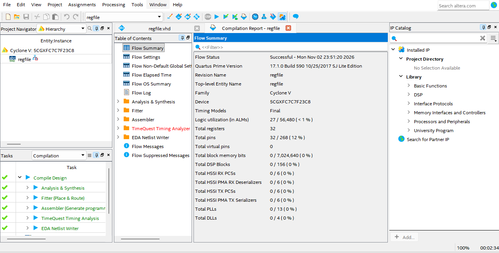
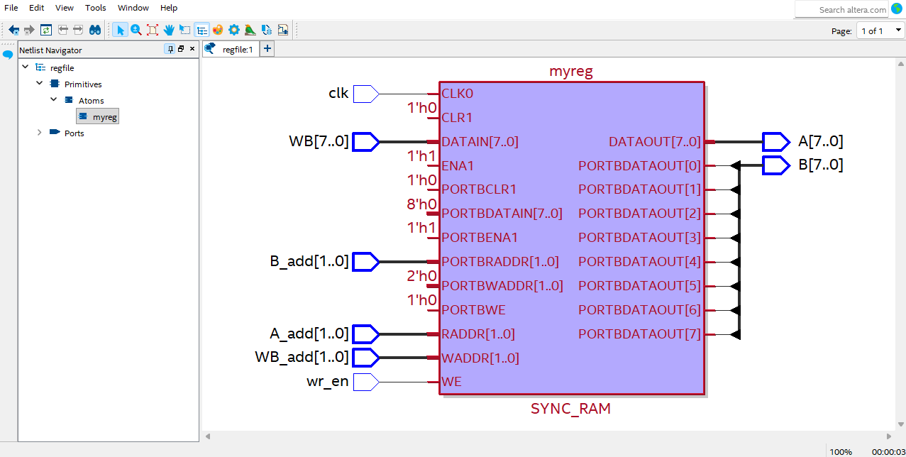
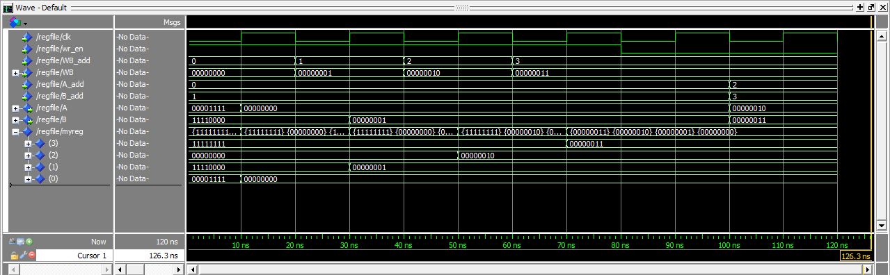
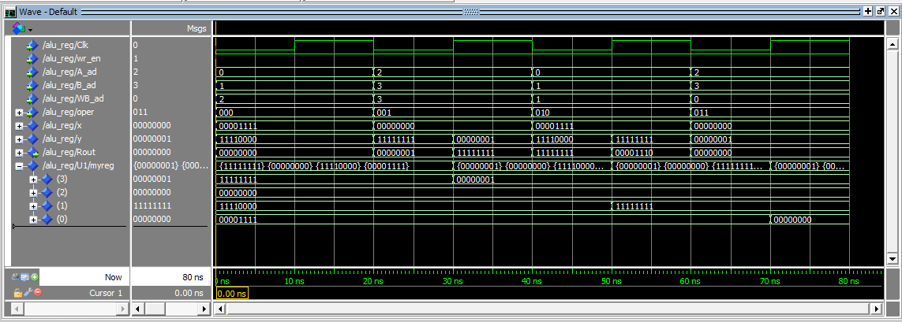

# Register File and ALU Datapath in VHDL

Another lab from my Computer Architecture course (ITCE362) at the University of Bahrain, where I'm studying Computer Engineering. This one comes right after my [8-bit ALU](https://github.com/hshamlooh6/vhdl-8bit-alu), and it's where things started to look like an actual CPU.

There are two parts. First, a small register file on its own. Then the register file connected to my ALU, so results get written back into the registers on every clock edge.

## Part 1: the register file

A register file is the small, fast storage inside a CPU where instructions get their operands from. This one has four 8-bit registers, R0 to R3. It can read two of them at once and write one:

- `A_add` picks which register shows up on output `A`, and `B_add` does the same for `B`
- `WB` gets written into the register picked by `WB_add`, but only on a rising clock edge and only when `wr_en` is 1

The code is in [`src/regfile.vhd`](src/regfile.vhd). I stored the registers as an array and used two processes, one for writing and one for reading. The write process waits for the clock. The read process doesn't, so `A` and `B` change as soon as the address changes. Our lab sheet actually said the read should be clocked too. But the lecture slides and the textbook (Patterson & Hennessy, RISC-V edition) both describe register files reading without the clock and only writing on the edge, so I went with that. It's also what lets a CPU read and write registers in the same cycle.

### Compiling it

It compiled without errors, and Quartus reported 32 registers, which is exactly 4 registers of 8 bits:



The RTL view was a nice surprise. Quartus turned my array into a single SYNC_RAM block, a little memory with one write port and two read ports. The lab intro even says register files are basically fast RAMs, and that's exactly what it built:



### Simulating it

The test from the lab: in the first four clock cycles I wrote 0, 1, 2 and 3 into R0 to R3. Then I read R0 and R1, and finally R2 and R3. The clock period is 20 ns.



You can see each register change on its rising edge. In cycle 5, A = 00000000 and B = 00000001 (R0 and R1). In cycle 6, A = 00000010 and B = 00000011 (R2 and R3).

## Part 2: connecting the ALU

Next I connected the register file to my ALU. The two registers being read go into the ALU as its inputs, and the ALU's answer goes back into the register file's write port. Every clock cycle it does R[WB_ad] = R[A_ad] op R[B_ad]. That's pretty much what happens when a CPU runs an instruction like `add x3, x1, x2`: read two registers, do the math, write the result back.

```
              +--------------+   x   +---------+
  A_ad  ----> |              |-----> |         |
  B_ad  ----> |   regfile    |   y   |   ALU   |--+--> Rout
  WB_ad ----> |     (U1)     |-----> |  (U2)   |  |
  wr_en ----> |              |       +----^----+  |
  Clk   ----> |           WB | <----------|-------+ res
              +--------------+            |
  oper  ----------------------------------+
```

I wrote it as a structural design: declare both parts as components, then wire them together with port maps. The code is in [`src/ALU_REG.vhd`](src/ALU_REG.vhd), and a copy of my ALU is in [`src/alu_if.vhd`](src/alu_if.vhd) so this repo works on its own.

### Simulating it

The registers start at R3 = 11111111, R2 = 00000000, R1 = 11110000 and R0 = 00001111. Then four cycles run:

| Cycle | Operation | Calculation | Stored |
|---|---|---|---|
| 1 | R2 = clear | | 00000000 |
| 2 | R3 = R2 - R3 | 00000000 - 11111111 | 00000001 |
| 3 | R1 = R0 + R1 | 00001111 + 11110000 | 11111111 |
| 4 | R0 = R2 and R3 | 00000000 and 00000001 | 00000000 |



Something confused me at first: `Rout` sometimes changes again right after the clock edge. In cycle 2, for example, it shows 00000001 and then jumps to 11111111. That's the loop. The new value gets written into R3, the ALU immediately recalculates using it, and `Rout` shows the new answer. The value that actually gets saved is whatever `Rout` was just before the edge.

## Testing it

After the course I added two testbenches that check everything automatically:

- `tb/tb_regfile.vhd` runs the same six cycles as above. It also makes sure nothing gets written when `wr_en` is 0.
- `tb/tb_alu_reg.vhd` checks the value written in each of the four cycles. Then it reads every register back through the ALU to confirm what ended up in them.

With [GHDL](https://github.com/ghdl/ghdl) installed (`sudo apt install ghdl` on Ubuntu), run this from the repo folder:

```bash
./scripts/run_tests.sh
```

```
=== tb_regfile ===
  REGISTER FILE PASSED: writes and reads are correct
=== tb_alu_reg ===
  ALU_REG PASSED: all 4 operations stored the right results
All testbenches passed.
```

They also run on GitHub every time I push. For the waveforms, open ModelSim in this folder and type `do sim/regfile_sim.do` or `do sim/alu_reg_sim.do`.

## Files

```
src/      regfile.vhd, ALU_REG.vhd, alu_if.vhd (my ALU)
tb/       tb_regfile.vhd, tb_alu_reg.vhd
sim/      regfile_sim.do, alu_reg_sim.do (the ModelSim scripts I used)
images/   screenshots from Quartus and ModelSim
scripts/  run_tests.sh
```

## What I took away from it

- How to write logic that only acts on a clock edge, and why it helps to keep clocked and non-clocked parts in separate processes.
- How to reuse something I'd already built as a component instead of rewriting it.
- Why a register file reads without the clock but writes with it, and how that creates the write-back loop you see in a real CPU datapath.

Tools: VHDL, Intel Quartus Prime Lite 17.1, ModelSim Intel FPGA Starter Edition 10.5b, GHDL, GitHub Actions.
